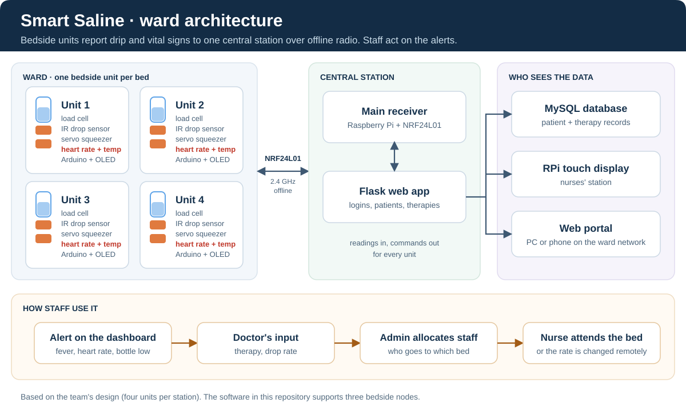
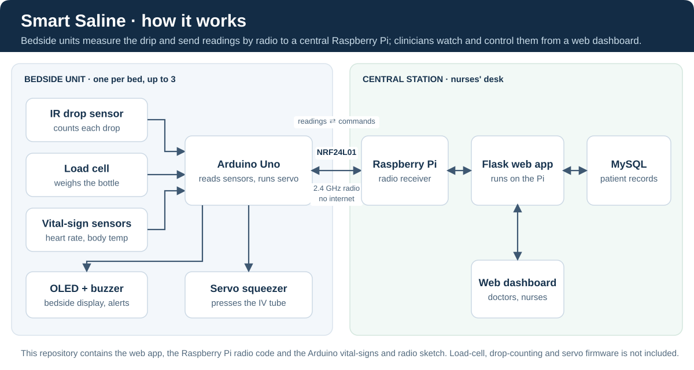
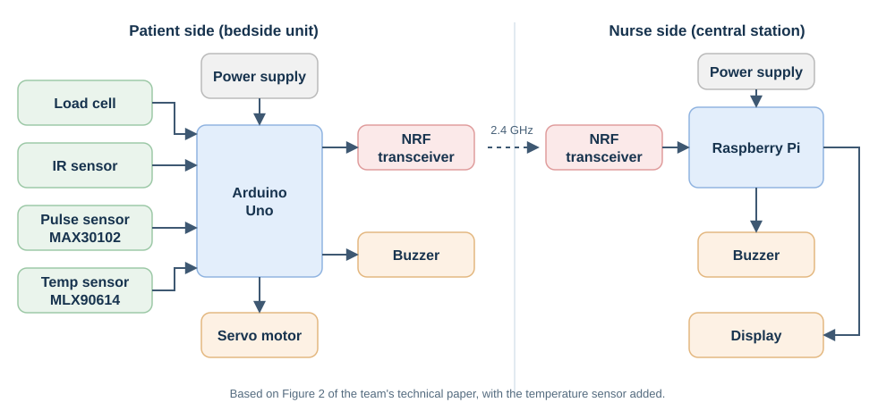
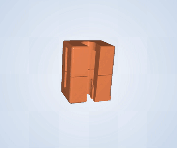
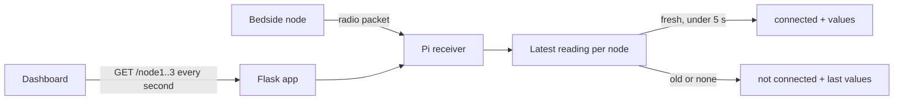

# System architecture

The system has two halves: a **bedside unit** at each bed, and a **central station** (a Raspberry Pi) at the nurses' desk. They talk over NRF24L01 radio, so no internet connection is needed.



Inside one bedside unit, and how its readings reach the dashboard:



## Hardware

| Component | Where | Job |
| --- | --- | --- |
| IR sensor module in a 3D-printed drip-chamber housing | Bedside | Counts drops |
| 1 kg load cell with HX711 amplifier | Bedside | Weighs the bottle to estimate fluid left |
| MAX30102 pulse sensor on the fingertip | Bedside | Measures the patient's heart rate |
| MLX90614 infrared thermometer | Bedside | Measures body temperature without contact |
| Arduino Uno | Bedside | Reads the sensors, drives the servo, talks to the radio |
| MG995 servo in the 3D-printed tube-squeezing mechanism | Bedside | Presses the IV tube to set, slow or stop the flow |
| OLED display and buzzer | Bedside | Local readout and alerts |
| nRF24L01 transceivers | Both | 2.4 GHz radio link |
| Raspberry Pi with TFT touch display | Central | Radio receiver, web server and nurses' display |



### 3D-printed parts

| Drip-chamber housing | Tube-squeezing mechanism |
| --- | --- |
|  |  |
| Clamps around the drip chamber and holds the IR sensor. [Video](videos/drip-chamber-housing-3d.mp4) | Holds the servo that pinches the IV tube. [Video](videos/tube-squeezing-mechanism-3d.mp4) |

## Software on the Raspberry Pi

| File | Job |
| --- | --- |
| `software/web/app.py` | Flask app: login, pages, patient and therapy records, device commands |
| `software/web/telemetry.py` | Keeps the latest reading for each bedside node and marks it stale after 5 seconds |
| `software/web/rx.py` | Sets up the NRF24 radio (only when first needed) and decodes packets |
| `software/web/lib_nrf24.py` | Third-party NRF24 driver (GPL-3.0) |
| `software/web/commands.py` | Runs the command sender and reports the result |
| `software/web/sender.py` | Sends a command to bedside node 1 or 2 over the radio |
| `firmware/nrf24_node/nrf24_node.ino` | Arduino sketch: reads heart rate and body temperature, sends them by radio, prints received commands |

### Live readings

The dashboard asks for each bed's latest reading every second.



Each request listens to the radio for up to 50 ms and stores any packet under the node it came from. If a node hasn't been heard from for 5 seconds (`TELEMETRY_STALE_SECONDS`), the dashboard shows it as not connected. If the radio itself fails, the request returns HTTP 503.

### Commands to the bed

| Action | Values sent after the channel number |
| --- | --- |
| Start therapy (sent when a therapy is saved) | drop factor, drop rate, volume ÷ 10 |
| Start button | `34` |
| Stop button | `43` |
| Finish (reset) | `55` |
| Change drop rate | new drop rate |

The web app saves the change to the database first, then runs `sender.py`, which repeats the command over the radio for two seconds. The dashboard shows both results separately: for example, "Therapy finished" and "Reset command: sender unavailable". The bedside node doesn't send back a confirmation, so a successful send means the command went out, not that the device acted on it. The bundled sender supports nodes 1 and 2; node 3 can send readings but not receive commands.

### Drop-rate calculation

```
drop rate (drops/min) = volume (mL) × drop factor (drops/mL) ÷ infusion time (min)
```

The result is rounded down and must be between 1 and 255 so it fits in one radio byte. The time remaining on the patient page is estimated from this prescribed rate, not measured.

## Live-reading API

`GET /node1`, `/node2`, `/node3` (login required) return JSON:

| Field | Meaning |
| --- | --- |
| `z` | Node requested (1–3) |
| `a` | Node number if its reading is fresh, otherwise 0 |
| `b` | Bottle reading (raw) |
| `c` | Rate reading (raw) |
| `d` | Drop count (raw) |
| `e` | Heart rate in beats per minute (0 = no reading yet) |
| `f` | Body temperature in tenths of a °C, so `368` = 36.8 °C (`null` or 0 = no reading) |
| `online` | `true` if a fresh reading exists and the radio is working |
| `age_seconds` | Age of the last reading, or `null` before the first one |
| `error` | Radio error message, or `null` |

`b`, `c` and `d` are raw numbers from the bedside node; the included sketch sends sample values for them. Heart rate and temperature are real units, measured by the sensors.

### Vital-sign warnings

The dashboard flags a patient with **Check vitals** when a fresh reading shows:

| Reading | Flagged when |
| --- | --- |
| Heart rate | below 50 or above 120 bpm |
| Body temperature | below 35.0 °C or at 38.0 °C and above |

The limits are in `software/web/static/js/script.js` (`VITALS`). Vital-sign readings are shown live and not stored in the database.

## Pages and routes

| Route | What it does |
| --- | --- |
| `/`, `/logout` | Log in and log out |
| `/index` | Active patients with live readings |
| `/Inactive` | Patients with no active therapy |
| `/reg`, `/submit_data` | Register a patient (security code required) |
| `/patient/<id>` | Patient details, the active therapy and past therapies. POST finishes the therapy |
| `/submit_iv_details` | Start a therapy (security code required; one per patient and one per channel) |
| `/buttons`, `/reset`, `/update_drop_rate` | Start/Stop, reset and change-rate commands |
| `/check_password`, `/check_stat` | Checks the page runs before submitting (the server checks again) |

## Database

| Table | Holds |
| --- | --- |
| `docs` | Clinician logins (hashed passwords) |
| `auth` | The shared security code (hashed) |
| `patient_reg` | Registered patients |
| `iv_details` | Therapies. A patient can have many, but only one active at a time |

Radio readings, including heart rate and temperature, are kept in memory, not in the database.

[Setup](setup.md) · [Implementation status](assessment.md) · [Back to README](../README.md)
